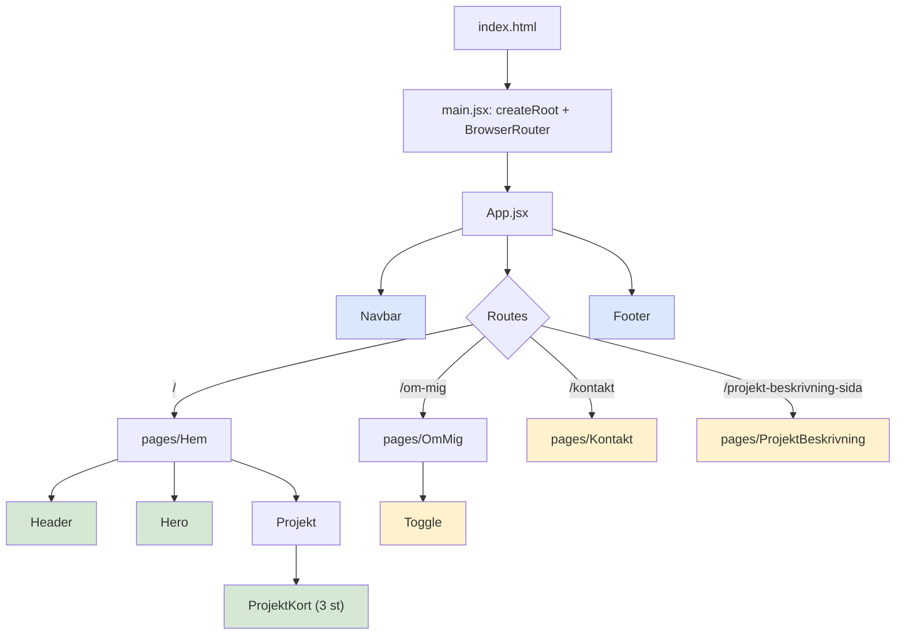
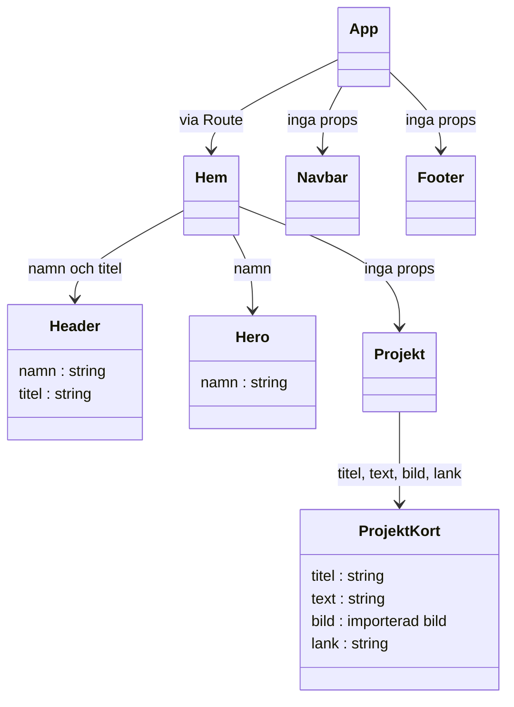
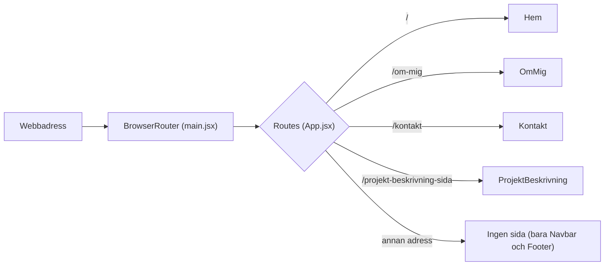
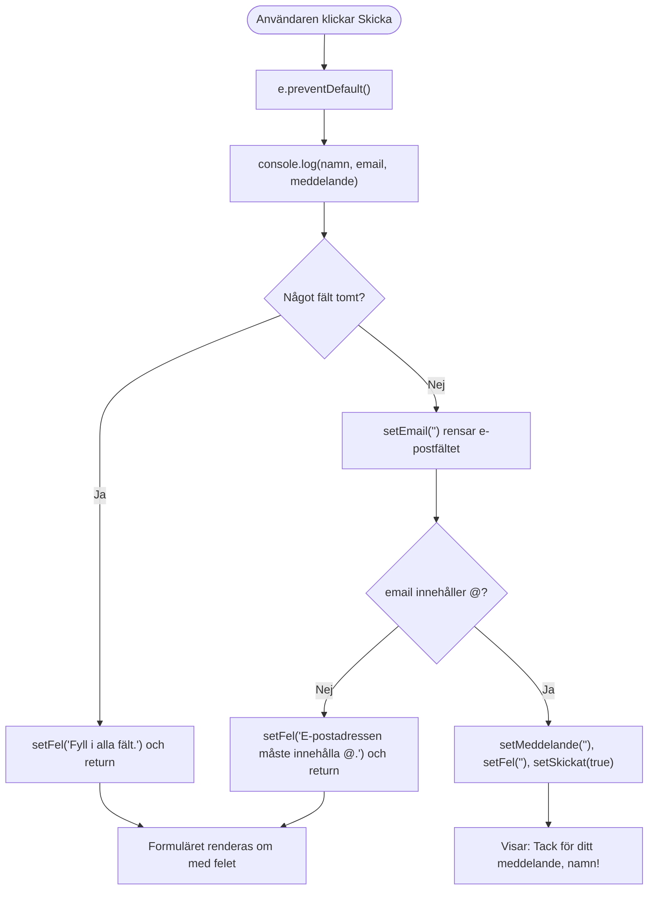
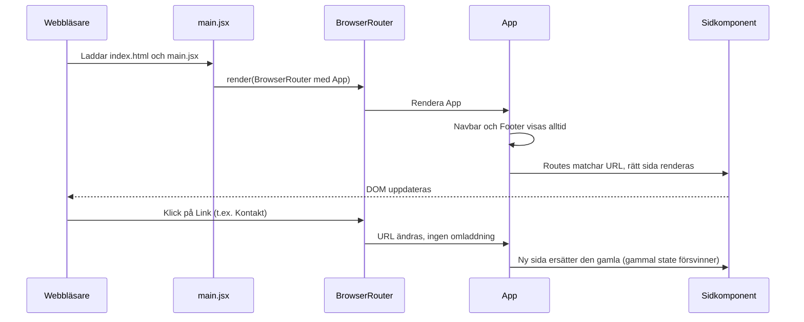

# Min portfolio

En personlig portfoliosida byggd med React. Här presenterar jag mig själv, mina projekt och det jag lär mig inom webbutveckling.

**Skapad av:** Donika Mehmeti

## Diagram

- [Räknarens flöde (PNG)](./docs/diagrams/Raknare-flode.drawio.png) · [redigerbar draw.io-fil](./docs/diagrams/Raknare-flode.drawio)
- [Applikationens arkitektur (PNG)](./docs/diagrams/Raknare-arkitektur.drawio.png) · [redigerbar draw.io-fil](./docs/diagrams/Raknare-arkitektur.drawio)

# Project_TTT

Duplicate from min-sida in documents repo. Code til 15Okt 2026.

## React + Vite

This template provides a minimal setup to get React working in Vite with HMR and some ESLint rules.

Currently, two official plugins are available:

- [@vitejs/plugin-react](https://github.com/vitejs/vite-plugin-react/blob/main/packages/plugin-react) uses [Oxc](https://oxc.rs)
- [@vitejs/plugin-react-swc](https://github.com/vitejs/vite-plugin-react/blob/main/packages/plugin-react-swc) uses [SWC](https://swc.rs/)

### React Compiler

The React Compiler is not enabled on this template because of its impact on dev & build performances. To add it, see [this documentation](https://react.dev/learn/react-compiler/installation).

### Expanding the ESLint configuration

If you are developing a production application, we recommend using TypeScript with type-aware lint rules enabled. Check out the [TS template](https://github.com/vitejs/vite/tree/main/packages/create-vite/template-react-ts) for information on how to integrate TypeScript and [`typescript-eslint`](https://typescript-eslint.io) in your project.


# Arkitektur och roadmap – Project_TTT (Min portfolio)

Repo: https://github.com/Thedoniki/Project_TTT
Uppdaterad mot `main` vid commit `6e06f5b` (Merge pull request #5), 23 oktober 2026.

## Vad som ändrats sedan förra versionen (a668d29 → 6e06f5b)

- `Kontakt.jsx` skrevs om: formuläret har nu **fem `useState`** (`namn`, `email`, `meddelande`, `skickat`, `fel`), en `handleSubmit` med validering och ett tackmeddelande.
- `ProjektBeskrivning.css`: bara färg- och vikt-justeringar.
- Nya diagram i `docs/diagrams/`: `ProjektBeskrivning-struktur` och `ProjektBeskrivning-visningsflode` (.mmd, .drawio, .png).
- `App.jsx`, `main.jsx`, `Hem.jsx` och alla komponenter i `src/components/` är **oförändrade**.

> **Om filnamnen:** Projektet har inga filer som heter `app.js`, `index.jsx` eller `userState`.
> - `app.js` → `src/App.jsx` (sidramverk och routing)
> - `index.jsx` → `src/main.jsx` (startpunkt, kopplar React till `<div id="root">`)
> - `userState` → finns inte som fil. Det finns ingen global state, context eller Redux. Allt state är lokalt med `useState` (avsnitt 4).

---

## 1. Startkedjan

```
index.html
  ├─ <div id="root">
  └─ <script src="/src/main.jsx">
        │
        ▼
src/main.jsx      createRoot(#root).render(...)
  ├─ importerar index.css (globala regler)
  └─ <BrowserRouter>        läser webbadressen
        └─ <App />
              │
              ▼
src/App.jsx       Navbar + <Routes> + Footer
```

`BrowserRouter` måste ligga runt `App` (det gör den i `main.jsx`). Annars fungerar inte `Routes` och `Link` i `App`, `Navbar` och `Footer`.

---

## 2. Komponentträd



Färgerna: blå = visas på alla sidor, grön = tar emot props, gul = har egen `useState`.

**Filer som finns men inte renderas någonstans:** `Valkommen`, `Halsning`, `Intressen`, `Raknare`.

---

## 3. Props – vem skickar vad till vem



Dataflödet är enkelriktat, uppifrån och ner, och värdena är hårdkodade som strängar i föräldrarna:

| Förälder | Barn | Props |
|---|---|---|
| `Hem.jsx` | `Header` | `namn="Niki"`, `titel="Overachever"` |
| `Hem.jsx` | `Hero` | `namn="Hero Niki"` |
| `Projekt.jsx` | `ProjektKort` (3 st) | `titel`, `text`, `bild`, `lank` |

Alla andra komponenter får inga props. Bilderna importeras i `Projekt.jsx` (inte i `ProjektKort`) eftersom `Projekt` bestämmer vilken bild varje kort får.

---

## 4. State – var finns tillstånd?

Ingen state delas mellan komponenter. Varje `useState` ligger lokalt:

| Komponent | State | Syfte |
|---|---|---|
| `Kontakt.jsx` | `namn`, `email`, `meddelande` | Kontrollerade input-fält |
| `Kontakt.jsx` | `skickat` (bool) | Visar tackmeddelande istället för formuläret |
| `Kontakt.jsx` | `fel` (string) | Visar valideringsfel |
| `ProjektBeskrivning.jsx` | `läsMer` (bool) | Visar eller döljer lång text |
| `Toggle.jsx` | `visas` (bool) | Växlar text och färg (används i `OmMig`) |
| `Raknare.jsx` | `antal` (number) | Räknare, **renderas inte** |

State i en komponent försvinner när du byter sida (komponenten avmonteras). Skickar du formuläret och går till "Hem" och tillbaka är formuläret tomt igen.

---

## 5. Routing



`Navbar` och `Footer` ligger utanför `Routes` och syns därför på alla sidor. "Om mig" och "Kontakt" använder `<Link>` (ingen sidomladdning). "Hem" och "Projekt" (`/#projekt`) är vanliga `<a href>`.

---

## 6. Flödesschema – kontaktformuläret (`Kontakt.jsx`)



Observera att `setEmail("")` körs **före** @-kontrollen, så e-postfältet töms även när valideringen misslyckas (se avsnitt 8).

---

## 7. Sekvensdiagram – sidan startar och användaren byter sida


